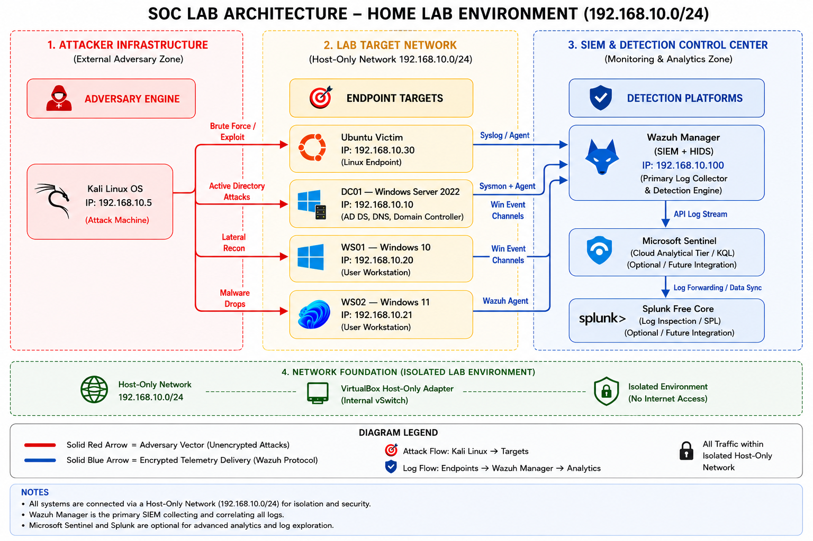

# SOC Blue Team Lab

A hands-on blue-team home lab documenting controlled attack simulations, security telemetry, SIEM detections, and investigation write-ups. The goal is to practise the workflow expected of a junior SOC analyst: understand an alert, identify relevant evidence, validate suspicious activity, document findings, and recommend an appropriate response.

> **Scope:** This is a personal, isolated lab portfolio. It is not a production SOC environment and does not represent real-world incident response for an organization. All systems, accounts, addresses, and credentials are synthetic lab data.

## At a glance

- **Environment:** VirtualBox lab using a host-only network (`192.168.10.0/24`)
- **Windows domain:** `SOC.LAB`
- **Monitoring and analysis:** Wazuh, Splunk, Windows Security logs, Sysmon, Wireshark/tcpdump
- **Cloud-SIEM learning:** KQL query examples are included; end-to-end Microsoft Sentinel ingestion is not claimed as complete in this repository
- **Detection content:** Custom Wazuh rules and experimental Sigma rules
- **Documentation:** Investigation reports, evidence screenshots, architecture notes, and query/script examples

## Lab architecture



| Host | Operating system | Role | Lab IP |
|---|---|---|---|
| Kali-Attacker | Kali Linux | Controlled attack simulation | `192.168.10.5` |
| DC01-Server | Windows Server 2022 | Active Directory domain controller | `192.168.10.10` |
| WS01-Client | Windows 10 | Domain workstation | `192.168.10.20` |
| WS02-Client | Windows 11 | Domain workstation | `192.168.10.21` |
| Ubuntu-Victim | Ubuntu Server 22.04 | Linux target and log-source exercises | `192.168.10.30` |
| Wazuh-SIEM | Ubuntu Server 22.04 | SIEM / monitoring server | `192.168.10.100` |

See [Architecture/README.md](Architecture/README.md) for the environment and network notes.

## Investigation portfolio

### Active Directory investigations

| ID | Investigation | ATT&CK techniques | Focus |
|---|---|---|---|
| AD-01 | [Active Directory enumeration](ActiveDirectory/Incident-AD-01-Enumeration/) | T1069.002, T1087.002 | LDAP enumeration and BloodHound attack-path discovery |
| AD-02 | [RDP brute force](ActiveDirectory/Incident-AD-02-RDPBruteForce/) | T1110.001, T1021.001 | Failed logons, Event ID 4625, threshold-based detection |
| AD-03 | [Kerberoasting](ActiveDirectory/Incident-AD-03-Kerberoasting/) | T1558.003 | Service-ticket requests and Kerberos telemetry |
| AD-04 | [AS-REP Roasting](ActiveDirectory/Incident-AD-04-ASREPRoasting/) | T1558.004 | Pre-authentication misconfiguration and Event ID 4768 |
| AD-05 | [Pass-the-Hash](ActiveDirectory/Incident-AD-05-PassTheHash/) | T1550.002, related T1003.001 | Credential access, NTLM authentication, lateral movement |

See the [Active Directory investigation index](ActiveDirectory/README.md).

### Threat-intelligence and phishing write-ups

- [LetsDefend email analysis](Writeups/threat-intel/LetsDefend-EmailAnalysis.md)
- [GrabThePhisher analysis](Writeups/threat-intel/grabthefisher.md)

### Detection content

- [Wazuh local rules](rules/wazuh/local_rules.xml)
- [Sigma - Active Directory](rules/sigma/ad/)
- [Sigma - Linux](rules/sigma/linux/)

The Sigma rules are marked experimental. Their log-source assumptions and field mappings should be validated against the target data source before operational use.

## SIEM and analysis tools

| Tool | How it appears in this portfolio |
|---|---|
| Wazuh | Custom local rules and alerting exercises |
| Splunk | SPL-based investigation evidence in selected reports |
| Microsoft Sentinel | KQL query examples in [Scripts/kql-queries.txt](Scripts/kql-queries.txt); ingestion status is not represented as complete here |
| Wireshark / tcpdump | Packet capture and network analysis exercises |
| BloodHound | Active Directory relationship and attack-path analysis |
| Impacket, Hydra, Nmap, Hashcat, Mimikatz | Controlled attack simulation in the isolated lab |

## Repository map

```text
.
├── README.md
├── ActiveDirectory/
│   ├── Incident-AD-01-Enumeration/
│   ├── Incident-AD-02-RDPBruteForce/
│   ├── Incident-AD-03-Kerberoasting/
│   ├── Incident-AD-04-ASREPRoasting/
│   ├── Incident-AD-05-PassTheHash/
│   └── README.md
├── Architecture/
│   ├── Lab-Diagram.png
│   └── README.md
├── Scripts/
│   ├── alert_notifier.py
│   ├── ioc_enrichment.py
│   ├── kql-queries.txt
│   └── noise_generator.sh
├── Wazuh-SIEM/
│   └── README.md
├── Writeups/
│   └── threat-intel/
├── rules/
│   ├── sigma/
│   │   ├── ad/
│   │   └── linux/
│   └── wazuh/
│       └── local_rules.xml
```

## Investigation documentation

The reports use a consistent incident-investigation structure where applicable:

1. Executive summary and scope
2. Timeline of observed activity
3. Attack or event description
4. Relevant host and security telemetry
5. Detection logic and SIEM evidence
6. MITRE ATT&CK mapping
7. Assessment, limitations, and defensive recommendations

Not every report contains every section yet; documentation is being standardized as the lab evolves.

## Current scope and next steps

- [x] Five Active Directory attack investigations documented
- [x] Wazuh custom local rules included
- [x] Experimental Sigma rules included
- [x] Phishing and threat-intelligence write-ups included
- [ ] Standardize all incident reports and evidence captions
- [ ] Validate and document the end-to-end Sentinel data-ingestion path
- [ ] Expand Linux investigation reports and SOC alert-triage case studies

## Safety and credential handling

All demonstrations are performed in a controlled lab. Public documentation intentionally uses placeholders instead of passwords, password hashes, API keys, or other reusable secrets. Screenshots containing credential material are excluded from the public repository. Never reuse lab credentials in personal or production environments.

## About

BTech Electrical Engineering student at **NIT Hamirpur**, building practical blue-team skills for SOC Analyst / Cybersecurity Analyst internship roles.

- Google Cybersecurity Certificate (Coursera)
- TryHackMe SOC Level 1
- [LinkedIn](https://www.linkedin.com/in/shakshi-sona/)

---

*This repository is an evolving learning portfolio. Project status is described conservatively; planned work is not presented as completed.*
